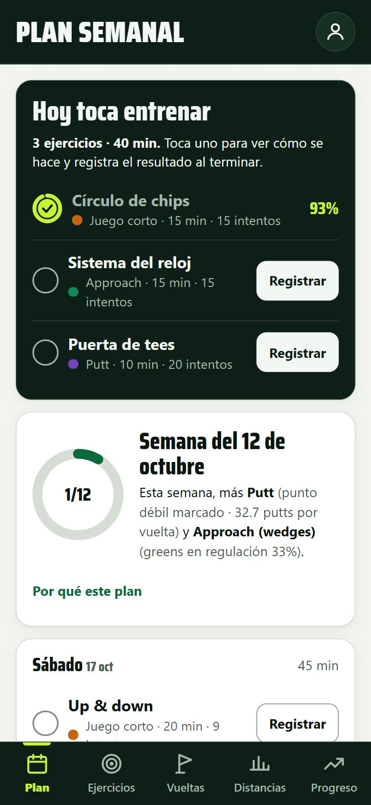
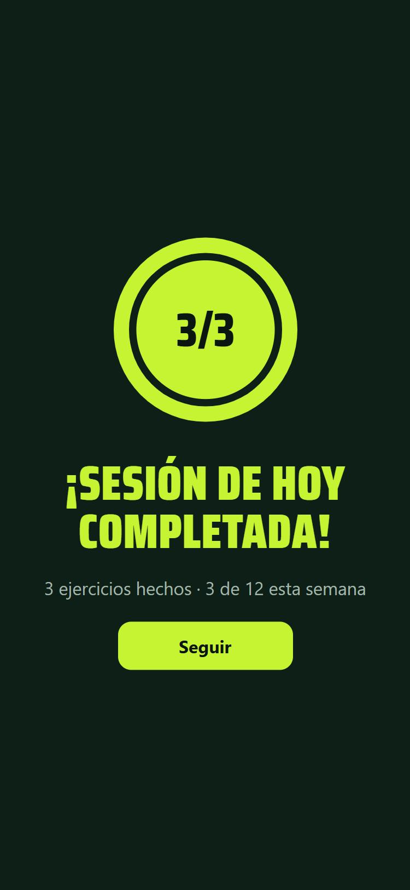
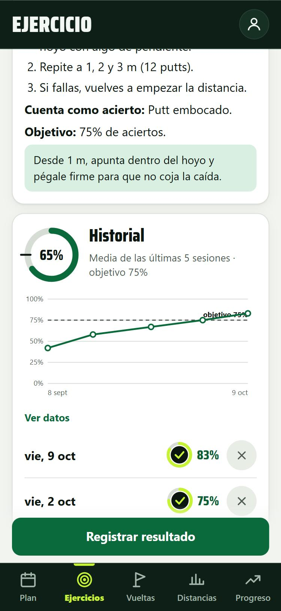
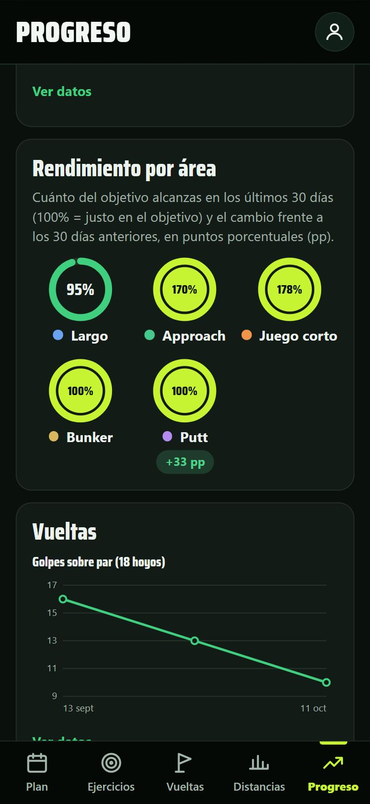

# Golf Plan

[](https://github.com/PruebaGHluis/App/actions/workflows/ci.yml)
[](https://github.com/PruebaGHluis/App/actions/workflows/codeql.yml)
[](https://scorecard.dev/viewer/?uri=github.com/PruebaGHluis/App)
[](LICENSE)

App web instalable en el móvil (PWA) para seguir un plan de entrenamiento de golf. Pensada para jugadores de nivel medio y avanzado que entrenan por su cuenta.

**Pruébala:** https://pruebaghluis.github.io/App/

<p>
  
  
  
  
</p>

<sub>Capturas con datos de ejemplo.</sub>

## Qué hace

- **Plan semanal**: se genera automáticamente según tu hándicap, tus días y tiempo disponibles, tus puntos débiles, tus últimas vueltas y tus resultados en los ejercicios. Te dice qué toca hoy y por qué.
- **Ejercicios**: 20 ejercicios de juego largo, approach, juego corto, bunker y putt, cada uno con un criterio de acierto y un objetivo en %.
- **Vueltas**: por totales o hoyo a hoyo (los greens en regulación y los up & down se calculan solos), de 9 o 18 hoyos. La app recuerda los pares, la valoración y el slope de cada campo.
- **Hándicap calculado**: índice WHS a partir de tus vueltas de 18 hoyos con valoración y slope (simplificado: sin ajuste de doble bogey neto).
- **Putt frente a una referencia**: si apuntas la distancia del primer putt, compara tus putts con una referencia profesional aproximada (tablas de Mark Broadie).
- **Prueba de nivel**: 30 bolas en 5 estaciones, siempre iguales, con una puntuación de 0 a 100 para medir tu evolución.
- **Distancias**: media, dispersión y rango por palo.
- **Progreso**: evolución por ejercicio, anillos de rendimiento por área y tendencias de tus vueltas.
- **Celebraciones** al cumplir un objetivo, completar la sesión del día o la semana.

Los datos se guardan solo en el dispositivo (localStorage). Desde **Perfil → Copia de seguridad** puedes exportarlos e importarlos.

## Usarla en el móvil

Abre https://pruebaghluis.github.io/App/ y añádela a la pantalla de inicio:

- **Android (Chrome)**: menú ⋮ → *Añadir a pantalla de inicio*.
- **iPhone (Safari)**: botón Compartir → *Añadir a pantalla de inicio*.

Una vez instalada, funciona sin conexión.

## Desarrollo

No necesita compilación ni dependencias. Para probarla en el PC:

```
powershell -ExecutionPolicy Bypass -File serve.ps1
```

y abre http://localhost:8080.

Los tests del motor del plan (`js/plan.js`) usan el runner de Node (versión 22 o superior):

```
npm test
```

Cada push y pull request ejecuta los tests en GitHub Actions; si pasan en `main`, la app se publica en GitHub Pages (en *Settings → Pages*, la fuente debe ser **GitHub Actions**).

Si cambias archivos de la app, sube la versión de `CACHE` en `sw.js` para que los móviles descarguen la nueva versión.

## Estructura

| Archivo | Contenido |
|---|---|
| `index.html` | Página y barra de navegación |
| `css/styles.css` | Estilos (incluye modo oscuro) |
| `js/app.js` | Pantallas, formularios y navegación |
| `js/data.js` | Biblioteca de ejercicios y palos |
| `js/plan.js` | Generador del plan y estadísticas |
| `js/charts.js` | Gráficas SVG |
| `js/store.js` | Guardado local |
| `sw.js`, `manifest.webmanifest` | Uso sin conexión e instalación |
| `fonts/` | Saira Condensed, autoalojada |
| `tests/` | Tests con `node:test` |
| `DESIGN.md`, `PRODUCT.md` | Sistema visual y descripción del producto |

## Contribuir y seguridad

- Errores y propuestas: [CONTRIBUTING.md](CONTRIBUTING.md).
- Vulnerabilidades: [SECURITY.md](SECURITY.md) (por aviso privado, no en issues).
- Cambios de cada versión: [CHANGELOG.md](CHANGELOG.md).

Cada cambio en `main` pasa por los tests, el análisis de CodeQL y OpenSSF Scorecard. Dependabot mantiene al día las acciones de GitHub, que van fijadas por hash.

Los ajustes de seguridad del repositorio (protección de `main`, Dependabot, secret scanning, avisos privados, permisos de Actions y Pages) se aplican con [scripts/configurar-github.ps1](scripts/configurar-github.ps1). Lo ejecuta la cuenta propietaria, después de iniciar sesión en GitHub CLI:

```
gh auth login
powershell -ExecutionPolicy Bypass -File scripts\configurar-github.ps1
```

Con `-SoloComprobar` revisa el estado sin cambiar nada.

## Licencia

El código de la app se publica con licencia [MIT](LICENSE).

- La fuente **Saira Condensed** (`fonts/`) es de The Saira Project Authors, con licencia [SIL Open Font License 1.1](fonts/OFL.txt).
- La herramienta de diseño **Impeccable** (`.claude/`) conserva su propia licencia.
